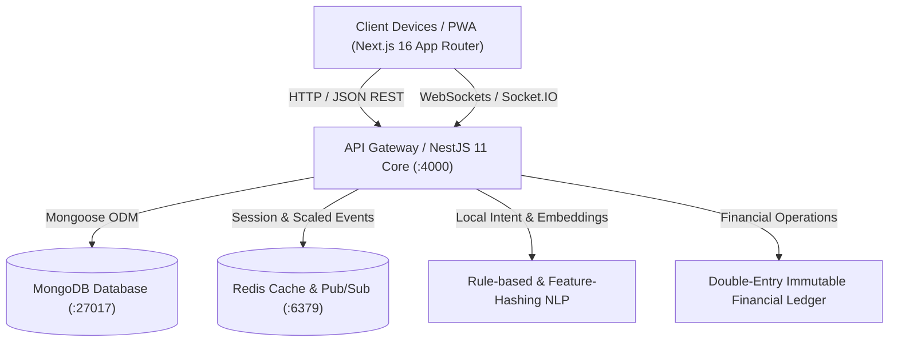

# NEEDX Official Documentation Hub

> **Version:** 1.0.0 | **Platform:** Next.js 16 + NestJS 11 + MongoDB Monorepo | **Status:** Active Development & Verified Functional  
> **Brand Philosophy:** *"Built on Hope. Guided by Faith. Earned Through Trust."*

---

## Welcome to the NEEDX Documentation

**NEEDX** is a next-generation, need-first marketplace platform. Rather than forcing users to navigate through rigid category taxonomies, NEEDX allows users to express their real-world needs in plain language (e.g., *"I need a projector for 2 days in Gurgaon under ₹3000"*). The platform parses the request, extracts intent, budget, duration, and geolocation, and matches the user with local individuals and businesses offering products, rentals, or services across multiple transaction modes (**Buy, Rent, Borrow, Hire, Exchange, Donate**).

This documentation hub provides an exhaustive, authoritative guide to the entire NEEDX repository—spanning architecture, development guidelines, operational usage, end-user workflows, production deployment, functional specifications, progress tracking, and gap analysis.

---

## Documentation Navigation Index

| Document | Description | Target Audience |
| :--- | :--- | :--- |
| [**1. Development Guide**](./development.md) | Architecture, monorepo tooling, environment setup, coding patterns, AI engine, and testing. | Engineers, Contributors, Architects |
| [**2. Usage & API Reference**](./usage.md) | How to run the platform, seed accounts, REST endpoints, Socket.IO events, and mock payment flows. | Developers, QA Engineers, Integrators |
| [**3. User Manual**](./user-manual.md) | Comprehensive step-by-step guides for Buyers, Providers, and Platform Administrators. | End Users, Support Staff, Operations |
| [**4. Deployment & Production Guide**](./deployment-and-production.md) | Docker orchestration, MongoDB Atlas, Redis, S3 storage, SSL/TLS, and security hardening. | DevOps, SysAdmins, SREs |
| [**5. Features & Functionality**](./features-and-functionality.md) | Deep-dive functional specifications of all 21 backend modules and frontend routes. | Product Managers, Technical Leads |
| [**6. Tasks: Completed & Pending**](./tasks-completed-and-pending.md) | Implementation audit, sprint tracking, and completed vs. pending tasks inventory. | Project Managers, Stakeholders |
| [**7. Missing Modules & Gap Analysis**](./missing-modules-and-gaps.md) | Honest assessment of missing modules, external dependencies, and future production roadmap. | Tech Leads, Engineering Leadership |

---

## Architectural Snapshot

### Key Technical Pillars
1. **Monorepo Structure:** Managed via `pnpm` workspaces and `Turborepo` with isolated builds for `@needx/types`, `@needx/validation`, and `@needx/config`.
2. **Deterministic State Machines:** Strict state transitions for both Offers (`SENT` → `VIEWED` → `COUNTERED` → `ACCEPTED`) and Orders (`PENDING` → `PAID` → `CONFIRMED` → `ACTIVE` → `COMPLETED`).
3. **Double-Entry Financial Ledger:** No arbitrary `balance += amount` manipulations. Every financial mutation is recorded as an immutable row in `ledger_entries`.
4. **Deterministic Local NLP & Semantic Engine:** Fully functional without third-party LLM API keys via regex/keyword entity extraction and djb2 feature-hashing cosine similarity vectors.
5. **Installable Progressive Web App (PWA):** Standalone mobile experience with service worker caching, offline fallback shell, and Web Push integration.

---

## Quick Reference

- **Frontend URL:** `http://localhost:3000`
- **Backend API URL:** `http://localhost:4000/api/v1`
- **Default Admin Demo:** `admin@needx.local` / `Needx@12345`
- **Default Provider Demo:** `aarav.provider@needx.local` / `Needx@12345`
- **Default User Demo:** `ananya@needx.local` / `Needx@12345`

For full details on spinning up the development environment, proceed to the [Development Guide](./development.md).
