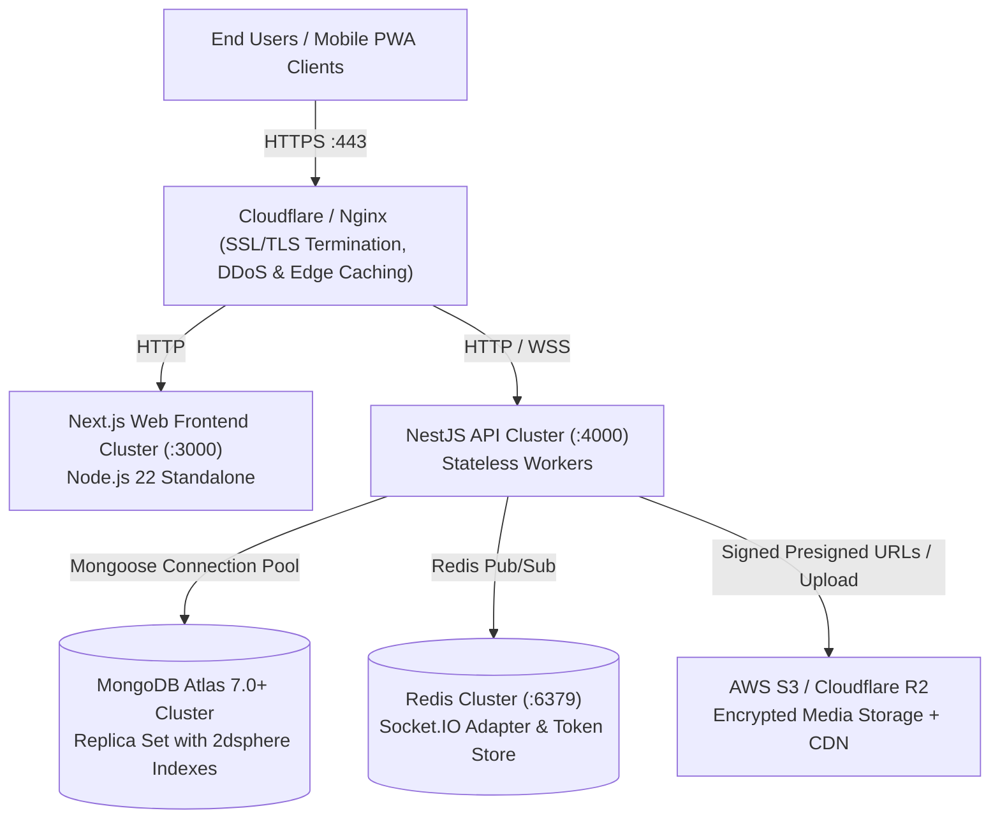

# NEEDX Deployment & Production Guide

> **Version:** 1.0.0 | **Audience:** DevOps Engineers, SREs, System Administrators

---

## 1. Production Architecture Overview

In a production environment, NEEDX operates as a decoupled, horizontally scalable system protected by an edge CDN/Reverse Proxy.



---

## 2. Docker Containerization

Both `apps/api` and `apps/web` feature production-ready, multi-stage `Dockerfile` implementations based on `node:22-slim`.

### Building Containers

```bash
# Build the backend API container
docker build -t needx-api:latest -f apps/api/Dockerfile .

# Build the frontend Web container (provide production public URLs)
docker build \
  --build-arg NEXT_PUBLIC_API_URL=https://api.needx.yourdomain.com \
  --build-arg NEXT_PUBLIC_APP_URL=https://needx.yourdomain.com \
  -t needx-web:latest -f apps/web/Dockerfile .
```

### Next.js Standalone Optimization
The web container leverages Next.js's `output: "standalone"` configuration. The resulting runner image contains only the exact required dependencies and statically compiled assets (`.next/standalone` + `.next/static`), drastically reducing final container size and memory footprint.

---

## 3. Production Database: MongoDB Atlas

For production deployments, replace the local containerized MongoDB with a managed **MongoDB Atlas (M10+) Replica Set**.

### Mandatory Database Indexes
Ensure the following indexes are present in your production database for optimal performance:

1. **Geospatial Indexes (Essential for Location Matching):**
   ```javascript
   db.listings.createIndex({ "location.coordinates": "2dsphere" });
   db.needs.createIndex({ "location.coordinates": "2dsphere" });
   ```
2. **Text Search Indexes:**
   ```javascript
   db.listings.createIndex({ title: "text", description: "text" });
   db.needs.createIndex({ title: "text", text: "text" });
   ```
3. **Compound & Unique Business Constraint Indexes:**
   ```javascript
   // Prevent duplicate reviews for the same order by the same author
   db.reviews.createIndex({ orderId: 1, authorId: 1 }, { unique: true });

   // Fast lookups for active user needs
   db.needs.createIndex({ userId: 1, status: 1 });

   // Filter active offers for a specific need
   db.offers.createIndex({ needId: 1, status: 1 });
   ```

---

## 4. Redis Configuration & Horizontal Scaling

While optional in simple local testing, **Redis is strongly recommended in production** for:

1. **Socket.IO Multi-Instance Scaling:**
   When scaling the NestJS API across multiple containers or Kubernetes pods, configure `@socket.io/redis-adapter` so WebSocket messages and presence events synchronize across nodes.
2. **Refresh Token Revocation / Blacklisting:**
   Store invalidated JWT tokens upon user logout to prevent replay attacks prior to token expiry.
3. **Distributed Rate Limiting:**
   Back the NestJS `ThrottlerModule` with a Redis storage engine (`throttler-storage-redis`) to enforce rate limits uniformly across all API replicas.

---

## 5. Cloud Object Storage (S3 / Cloudflare R2)

In production, avoid local filesystem storage (`STORAGE_DRIVER=local`). Configure S3-compatible cloud storage:

```env
STORAGE_DRIVER=s3
STORAGE_BUCKET=needx-production-assets
STORAGE_REGION=ap-south-1
STORAGE_ENDPOINT=https://s3.ap-south-1.amazonaws.com
STORAGE_ACCESS_KEY_ID=AKIA...
STORAGE_SECRET_ACCESS_KEY=...
STORAGE_PUBLIC_BASE_URL=https://assets.needx.yourdomain.com
```

Files are served through a dedicated CDN distribution (e.g., Cloudflare or CloudFront) with aggressive caching headers (`Cache-Control: public, max-age=31536000, immutable`).

---

## 6. Email, SMS & Web Push Services

### Transactional Email (Resend / SendGrid / AWS SES)
Set real SMTP credentials in your production `.env`:
```env
SMTP_HOST=smtp.resend.com
SMTP_PORT=587
SMTP_SECURE=false
SMTP_USER=resend
SMTP_PASSWORD=re_...
SMTP_FROM="NEEDX Platform <notifications@needx.yourdomain.com>"
```

### Web Push VAPID Keys
To enable push notifications on mobile and desktop devices without third-party services:
```bash
pnpm --filter @needx/api run vapid:generate
```
Copy the resulting public and private keys into your production environment:
```env
WEB_PUSH_PUBLIC_KEY=BG...
WEB_PUSH_PRIVATE_KEY=...
WEB_PUSH_CONTACT="mailto:support@needx.yourdomain.com"
```

---

## 7. Security & Hardening Checklist

Before launching to live traffic, verify the following critical security configurations:

- [ ] **`COOKIE_SECURE=true`:** Strictly enforce secure cookies. Browsers reject cookies marked `Secure` when sent over plain HTTP, preventing credential transmission over unencrypted connections.
- [ ] **`CORS_ORIGIN`:** Hard-pin this to your exact frontend domain (e.g., `https://needx.yourdomain.com`). Never leave this wildcarded (`*`) when handling credentials.
- [ ] **JWT Secrets:** Generate cryptographically secure 256-bit keys for `JWT_SECRET` and `JWT_REFRESH_SECRET` using `openssl rand -hex 32`.
- [ ] **Webhook Verification:** Set a robust `PAYMENT_WEBHOOK_SECRET` shared exclusively with your payment gateway.
- [ ] **Reverse Proxy SSL/TLS:** Terminate SSL at Nginx or Cloudflare using modern TLS 1.3 ciphers with HSTS enabled:
  ```nginx
  add_header Strict-Transport-Security "max-age=63072000; includeSubDomains; preload" always;
  add_header X-Content-Type-Options "nosniff" always;
  add_header X-Frame-Options "DENY" always;
  ```
- [ ] **Database Network Isolation:** Restrict MongoDB Atlas network access strictly to the static IP addresses of your API cluster or configure AWS VPC Peering.

---

## 8. Healthchecks & Monitoring

The NestJS API exposes a foundational healthcheck endpoint:
- **`GET /api/v1/health`** — Validates process uptime and database connection status.

For container orchestration (e.g., Kubernetes or AWS ECS):
```yaml
livenessProbe:
  httpGet:
    path: /api/v1/health
    port: 4000
  initialDelaySeconds: 15
  periodSeconds: 20
readinessProbe:
  httpGet:
    path: /api/v1/health
    port: 4000
  initialDelaySeconds: 5
  periodSeconds: 10
```
