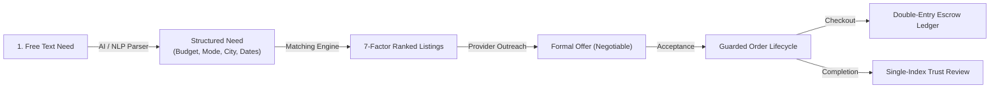
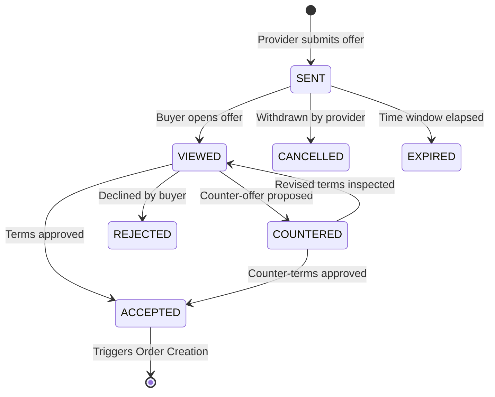

# NEEDX Features & Functionality Specification

> **Version:** 1.0.0 | **Audience:** Product Managers, Technical Leads, Software Engineers

---

## 1. Feature Architecture Overview

NEEDX provides an end-to-end transactional marketplace infrastructure centered around **Needs**, backed by a 21-module NestJS API architecture and a responsive Next.js 16 App Router frontend.

---

## 2. Core Modules & Functionality

### 2.1 Needs Engine & Semantic Parsing
- **Natural Language Parsing (`/needs/parse`):** Real-time extraction of user intent, transaction mode (`BUY`, `RENT`, `BORROW`, `HIRE`, `EXCHANGE`, `DONATE`), financial ceilings, and target city without forcing manual dropdown selection.
- **Need Lifecycle:** Tracks progression across `DRAFT`, `ACTIVE`, `MATCHING`, `FULFILLED`, `EXPIRED`, and `CANCELLED`.
- **Geospatial Anchoring:** Coordinates recorded via GeoJSON `Point` schemas for spatial radius lookups.

### 2.2 7-Factor Weighted Matching Engine
Candidates are scored and ranked against open needs using a strictly normalized weighting formula:

$$\text{MatchScore} = \sum_{i=1}^{7} (W_i \times S_i) \quad \text{where} \quad \sum W_i = 1.0$$

| Dimension | Weight ($W_i$) | Calculation Logic |
| :--- | :---: | :--- |
| **Semantic Relevance** | 30% | 50% exact category match + 50% cosine similarity between djb2 feature-hash embedding vectors. |
| **Geospatial Proximity** | 20% | Great-circle Haversine distance with linear falloff to 0 at a 50 km boundary. |
| **Price Competitiveness** | 15% | Score of 1.0 within budget limit; decaying penalty for quotes exceeding `budgetMax`. |
| **Availability** | 10% | Binary verification: listing is `ACTIVE` with available inventory ($> 0$). |
| **Provider Rating** | 10% | Provider's verified average star rating (neutral 0.6 assigned to newly registered providers). |
| **Fulfillment Reliability** | 10% | Derived from historical completion: $(1 - \text{cancellationRate})$. |
| **Response Velocity** | 5% | Provider's measured response rate on previous inquiries. |

### 2.3 Listings & Catalog Subsystem
- **Multi-Modal Offerings:** Supports physical items (`PRODUCT`), equipment rentals (`RENTAL`), and freelance services (`SERVICE`).
- **Flexible Rate Units:** Accommodates billing per `ITEM`, `DAY`, `HOUR`, or fixed-price `SERVICE`.
- **Rental Safeguards:** Configurable mandatory security deposits, inspection checklists, and minimum/maximum rental duration rules.

### 2.4 Offer & Negotiation State Machine
Negotiations between buyers and providers are governed by an explicit state machine:

### 2.5 Order Processing Lifecycle
Orders are guarded against unauthorized or invalid state transitions by `order-status.util.ts`:

- `PENDING` $\rightarrow$ `PAYMENT_PENDING` $\rightarrow$ `PAID` $\rightarrow$ `CONFIRMED` $\rightarrow$ `READY` $\rightarrow$ `ACTIVE` $\rightarrow$ `COMPLETED`
- **Exception Transitions:**
  - `CANCELLED` is a terminal state (no outgoing transitions allowed).
  - Orders may enter `DISPUTED` from `CONFIRMED`, `READY`, `ACTIVE`, or `COMPLETED`.
  - Orders may transition to `REFUNDED` upon dispute arbitration or pre-dispatch cancellation.

### 2.6 Rental Escrow & Deposit Management
- **Escrow Isolation:** Security deposits are isolated in dedicated escrow records separate from operational service fees.
- **Return Inspection:** Upon return, providers document condition and trigger deposit releases.
- **Damage Deductions:** Allows documented deduction from deposits for damages, subject to dispute arbitration.

### 2.7 Double-Entry Financial Ledger
NEEDX enforces strict financial accounting rules:
- **Zero In-Memory Balance Mutability:** Balance updates are never performed via direct arithmetic (`balance += x`).
- **Immutable Ledger Rows:** Financial facts are recorded in `ledger_entries` under strict categories:
  - `CUSTOMER_PAYMENT`, `PLATFORM_FEE`, `PROVIDER_PAYABLE`, `REFUND`, `DEPOSIT`, `DEPOSIT_RELEASE`, `PENALTY`, `ADJUSTMENT`, `PAYOUT`.
- **Derived Balances:** Account balances are computed dynamically as aggregate queries over immutable ledger rows.

### 2.8 Real-Time Chat & Communications
- **Contextual Threading:** Chat threads are automatically bound to specific transaction contexts (`NEED`, `OFFER`, or `ORDER`).
- **Interactive Chat Cards:** Real-time messages support embedded rich cards (`OFFER_CARD`, `COUNTER_OFFER_CARD`, `ORDER_CARD`) allowing direct interaction inside the conversation.
- **WebSockets via Socket.IO:** Low-latency bi-directional messaging with fallback to HTTP polling.

### 2.9 Trust, Safety & Moderation
- **Anti-Fraud Single Review Constraint:** Enforced via a composite unique database index (`{ orderId: 1, authorId: 1 }`), ensuring parties can submit at most one verified review per order.
- **Automated Content Moderation:** Keyword screen automatically flags prohibited or high-risk inventory for human review.
- **Dispute Resolution Engine:** Dedicated workflows for arbitrating claims, holding escrow, and executing split or full refunds.

### 2.10 Progressive Web App (PWA) Capabilities
- **Web App Manifest:** Standalone mobile app launch experience with custom brand theme tokens.
- **Service Worker (`sw.js`):** Intelligently caches static assets, navigation shells, and iconography.
- **Offline Shell (`/offline`):** Provides a graceful fallback experience when network connectivity is lost.
- **Mobile Bottom Navigation:** Thumb-friendly navigation bar engineered for one-handed smartphone operation.
