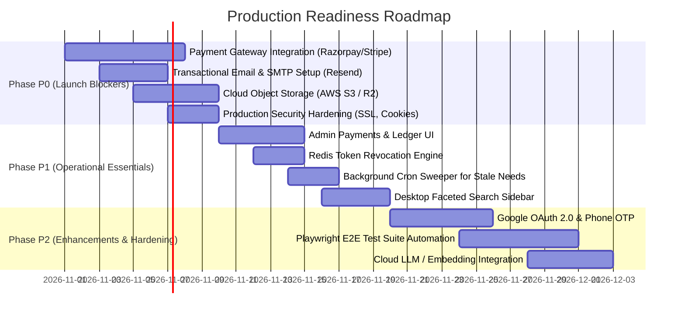

# NEEDX Gap Analysis: Missing Modules & Roadmap

> **Version:** 1.0.0 | **Audience:** Technical Leadership, System Architects, Product Owners

---

## 1. Executive Gap Summary

NEEDX has successfully implemented the **core transactional backbone** (Need $\rightarrow$ Match $\rightarrow$ Offer $\rightarrow$ Order $\rightarrow$ Escrow Ledger $\rightarrow$ Review) with real state machine enforcement. 

However, before launching to live consumer and commercial traffic, several architectural gaps, unintegrated third-party services, and missing administrative views must be addressed.

---

## 2. Missing & Incomplete Platform Modules

### 2.1 Dedicated Admin Payments & Ledger View
- **Current State:** The backend possesses a double-entry financial ledger (`LedgerModule` and `ledger_entries` collection) and an internal controller, but there is no dedicated user interface at `/admin/payments` or `/admin/ledger`.
- **Impact:** Platform administrators cannot currently audit real-time escrow balances, dispute withholdings, or payout states from the web UI; they must query MongoDB directly.
- **Required Fix:** Create `apps/web/src/app/admin/payments/page.tsx` displaying transaction logs, total platform fee accruals, and escrow liability tables.

### 2.2 Public Provider Directory & Search
- **Current State:** Providers can be discovered indirectly through matched listings, but there is no standalone public directory (`/providers`) where buyers can browse verified providers by city, rating, and service category.
- **Impact:** Limits organic discovery of top-rated service professionals.
- **Required Fix:** Implement a faceted `/providers` search interface leveraging provider profile ratings and geographic proximity.

### 2.3 Desktop Faceted Search Sidebar
- **Current State:** Mobile users have access to a slide-over `FilterDrawer`. On desktop screens, however, the faceted filter panel (category checkboxes, price range sliders, distance radius) is incomplete.
- **Required Fix:** Build a responsive desktop `FilterSidebar` component for `apps/web/src/app/search/page.tsx`.

### 2.4 User Account Suspension & Ban UI
- **Current State:** The `User` Mongoose schema contains an `isBanned` boolean, and the auth service prevents banned users from authenticating. However, `PublicUser` wire types omit `isBanned` for privacy reasons, preventing the admin user table (`/admin/users`) from displaying a quick ban/unban button.
- **Required Fix:** Introduce an `AdminUserView` DTO that includes `isBanned` and add moderation action buttons to the admin users dashboard.

### 2.5 Automated Background Cron Workers
- **Current State:** Needs and Offers have `EXPIRED` status definitions, but status transitions currently rely on lazy evaluations when documents are loaded.
- **Impact:** Expired needs continue to appear in active search queries until evaluated.
- **Required Fix:** Implement a NestJS Schedule / BullMQ cron job that runs periodically to transition stale needs and offers to `EXPIRED`.

---

## 3. Mocked Services vs. Production Requirements

In accordance with clean engineering practices, all external third-party dependencies were written behind injectable interfaces with working local dev fallbacks. To enter production, these interfaces must be connected to real cloud providers.

| Subsystem | Current Dev Fallback | Production Requirement | Action Required |
| :--- | :--- | :--- | :--- |
| **Payment Gateway** | `MockPaymentProvider` (Simulated checkout at `/pay/mock/[ref]`) | **Razorpay** (India) or **Stripe** (International) | Implement `PaymentProvider` interface using Razorpay SDK; configure webhook endpoint with live signature verification. |
| **Transactional Email** | `ConsoleEmailProvider` (Prints emails to terminal stdout) | **Resend**, **SendGrid**, or **AWS SES** | Configure SMTP credentials or integrate Resend API; enable real verification links and password reset emails. |
| **SMS / Mobile OTP** | `ConsoleSmsProvider` (Prints OTPs to terminal stdout) | **Twilio**, **Fast2SMS**, or **MSG91** | Implement `SmsProvider` interface for real phone authentication and SMS notifications. |
| **Media & File Storage** | `LocalStorageProvider` (Saves to `apps/api/uploads/`) | **AWS S3** or **Cloudflare R2** | Bind `StorageProvider` to S3 SDK; implement presigned upload URLs and serve media via a global CDN. |
| **AI / Semantic Engine** | Local regex parser + djb2 feature-hash embeddings | **OpenAI GPT-4o-mini**, **Google Gemini**, or **Anthropic Claude** | Implement `NeedsParserService` calling an LLM API for advanced multilingual comprehension; use vector embeddings for enhanced semantic matching. |
| **Token Invalidation** | Client-side cookie clearing only | **Redis-backed Token Blacklist** | Wire `REDIS_URL` to blacklist revoked refresh tokens on logout to prevent replay attacks. |

---

## 4. Authentication & Security Gaps

1. **Google OAuth 2.0 Integration:**
   - The Passport strategy exists in `apps/api/src/modules/auth/strategies/google.strategy.ts`, but returns a configuration error because `GOOGLE_CLIENT_ID` and `GOOGLE_CLIENT_SECRET` are unconfigured.
2. **Phone Number OTP Login:**
   - The user schema supports phone numbers, but phone verification routes and SMS gateway dispatch are pending.
3. **Session Revocation via Redis:**
   - While Redis is configured in `docker-compose.yml`, the API does not currently record invalidated refresh tokens in Redis upon logout.

---

## 5. Testing & Quality Assurance Gaps

1. **Frontend Unit & Component Tests:**
   - `apps/web` currently has no automated component tests configured. A Vitest + React Testing Library setup is needed to test core components (`Hero`, `NeedSection`, `ListingCard`, `OfferCard`).
2. **End-to-End (E2E) Browser Testing:**
   - The repository lacks Playwright or Cypress automated browser test suites. The 4 critical marketplace flows must be automated:
     1. Post a need $\rightarrow$ Verify parsed output.
     2. Provider offer dispatch $\rightarrow$ Buyer notification $\rightarrow$ Negotiation.
     3. Checkout flow $\rightarrow$ Webhook confirmation $\rightarrow$ Order generation.
     4. Rental return inspection $\rightarrow$ Deposit release.
3. **Performance & Stress Testing:**
   - Geospatial index query performance under high load (100k+ listings) needs validation using k6 or Artillery.

---

## 6. Prioritized Gap Closure Roadmap

### Phase P0: Launch Blockers (Must Have Before First Real Transaction)
1. Integrate a live payment gateway (Razorpay for INR transactions or Stripe).
2. Switch from local disk file storage to AWS S3 or Cloudflare R2.
3. Configure live transactional email (Resend / SendGrid) for account verification and security alerts.
4. Set `COOKIE_SECURE=true` and enforce HTTPS domain pinning.

### Phase P1: Operational Essentials (Required for Platform Management)
1. Build the `/admin/payments` ledger browser for escrow and fee audits.
2. Implement Redis token blacklisting for secure session invalidation.
3. Deploy automated cron jobs for expiring stale needs and offers.
4. Complete the desktop faceted search sidebar.

### Phase P2: Platform Hardening & Enhancements
1. Add Google OAuth 2.0 and phone OTP login.
2. Implement automated E2E browser tests using Playwright.
3. Connect live LLM provider (OpenAI / Gemini) for advanced multilingual parsing.
