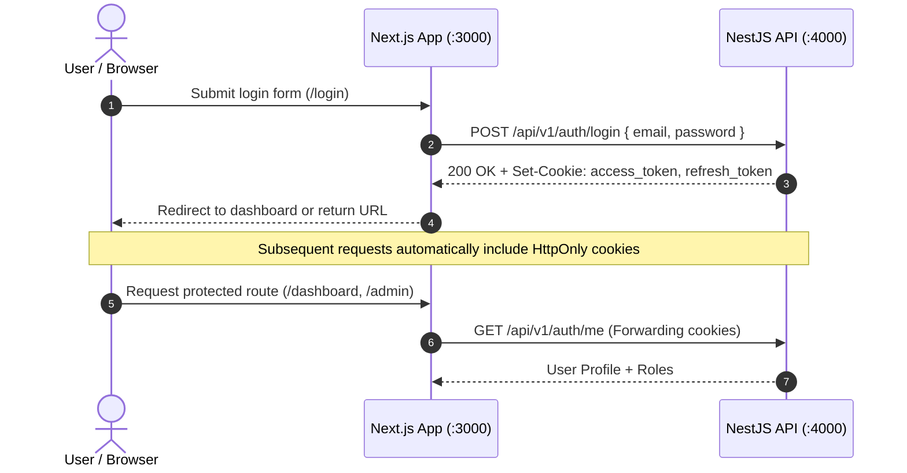

# NEEDX Usage & API Guide

> **Version:** 1.0.0 | **Audience:** Developers, QA Engineers, Integrators, API Consumers

---

## 1. Quick Start & Execution Modes

### Prerequisites
- **Node.js:** `v20.9.0` or higher
- **Package Manager:** `pnpm` (run `corepack enable` if pnpm is not pre-installed)
- **Database:** Local MongoDB instance running on port `27017` or Docker

### Running Option A: Native Development (Recommended)

1. **Start Datastores via Docker:**
   ```bash
   docker compose up -d mongodb redis
   ```
2. **Initialize Environment Variables:**
   ```bash
   cp .env.example .env
   ```
   *(Ensure `JWT_SECRET` and `JWT_REFRESH_SECRET` are set to at least 16 random characters).*
3. **Populate Database with Seed Data:**
   ```bash
   pnpm seed
   ```
4. **Launch Application Servers:**
   ```bash
   pnpm dev
   ```
   - Web application is available at **http://localhost:3000**
   - API server is available at **http://localhost:4000/api/v1**

### Running Option B: Full Containerized Stack

```bash
docker compose up -d mongodb redis
pnpm seed
docker compose up --build
```

---

## 2. Seed Accounts & Credentials

The seed script (`pnpm seed`) populates MongoDB with realistic Indian marketplace data across several Indian cities (Delhi, Gurgaon, Noida, Bangalore, Mumbai, Hyderabad, Pune).

**Universal Password for all Seed Accounts:** `Needx@12345`

| Email Address | Role | Default Location | Description / Purpose |
| :--- | :--- | :--- | :--- |
| `admin@needx.local` | `ADMIN` | Delhi | Full platform administrative access (`/admin`). |
| `aarav.provider@needx.local` | `PROVIDER` (Individual) | Gurgaon | Electronics & projector rentals, DSLR equipment. |
| `priya.provider@needx.local` | `PROVIDER` (Professional) | Bangalore | Professional photography & event services. |
| `toolhub@needx.local` | `PROVIDER` (Business) | Noida | Tool & machinery rentals (drills, ladders). |
| `renteasy@needx.local` | `PROVIDER` (Business) | Mumbai | Event sound equipment & home furniture. |
| `ananya@needx.local` | `USER` | Delhi | General consumer with active needs in Delhi. |
| `rohan@needx.local` | `USER` | Gurgaon | General consumer needing tools in Gurgaon. |

---

## 3. Authentication & Session Architecture

Authentication is managed through secure, JSON Web Tokens stored in **HttpOnly, SameSite cookies**.



### Authentication Endpoints
- `POST /api/v1/auth/register` — Create new user account.
- `POST /api/v1/auth/login` — Authenticate and receive session cookies.
- `POST /api/v1/auth/refresh` — Issue a new access token using the valid refresh cookie.
- `POST /api/v1/auth/logout` — Invalidate session and clear client cookies.
- `GET /api/v1/auth/me` — Retrieve the currently authenticated user's profile.

---

## 4. REST API Reference

All API routes are prefixed with `/api/v1`.

### Needs Module (`/needs`)
- `GET /needs` — Paginated list of active needs with optional filtering by `category`, `city`, `mode`, and text query.
- `GET /needs/:id` — Detailed view of a single need, including matched listings.
- `POST /needs` — Create a new need. Requires authentication.
- `POST /needs/parse` — AI / Natural Language parser preview. Extracts budget, duration, mode, category, and city without persisting.
- `PATCH /needs/:id` — Update need parameters (only permitted for the author in `ACTIVE` or `DRAFT` status).
- `DELETE /needs/:id` — Cancel an active need.

### Listings Module (`/listings`)
- `GET /listings` — Paginated marketplace listings with geospatial and category filtering.
- `GET /listings/:id` — Public listing details including provider trust metrics.
- `POST /listings` — Publish a new product, service, or rental listing (`PROVIDER` role required).
- `PATCH /listings/:id` — Update listing details or inventory.
- `DELETE /listings/:id` — Archive listing.

### Offers & Negotiation (`/offers`)
- `GET /offers/received` — Offers received by the buyer for their needs.
- `GET /offers/sent` — Offers sent by the provider.
- `POST /offers` — Create and dispatch an offer for an active need.
- `POST /offers/:id/counter` — Submit a counter-offer with revised pricing or terms.
- `POST /offers/:id/accept` — Accept offer (triggers automated creation of an associated Order).
- `POST /offers/:id/reject` — Decline offer.

### Orders & Rentals (`/orders`, `/rentals`)
- `GET /orders` — List orders for the current user (as buyer or provider).
- `GET /orders/:id` — Order status, timeline, payment status, and contract terms.
- `POST /orders/:id/transition` — Advance order state (`CONFIRMED`, `READY`, `ACTIVE`, `COMPLETED`).
- `GET /rentals` — Track active rentals, scheduled return dates, and security deposits.
- `POST /rentals/:id/return` — Initiate return inspection for rented equipment.
- `POST /rentals/:id/release-deposit` — Release escrowed security deposit back to the renter.

### Reviews & Ratings (`/reviews`)
- `POST /reviews` — Submit review and star rating (1–5) for an order.
  *(Enforced rule: exactly one review per participant per order via unique composite database index).*
- `GET /reviews/provider/:providerId` — Public reviews for a provider.

---

## 5. Mock Payment & Webhook Simulation Flow

NEEDX includes a complete, end-to-end payment simulator that exercises real cryptographic HMAC signatures and idempotent database writes.

### Step-by-Step Payment Walkthrough:
1. Log in as a buyer (e.g., `ananya@needx.local`).
2. Accept an offer on an active need to create an order.
3. On the order confirmation page, click **"Proceed to Payment"**.
4. You will be redirected to the development checkout route:
   ```
   http://localhost:3000/pay/mock/[payment_reference]
   ```
5. Click **"Simulate Successful Payment"**.
6. The test runner generates an HMAC-SHA256 signature using `PAYMENT_WEBHOOK_SECRET` and fires a server-to-server POST request to:
   ```
   POST /api/v1/payments/webhook
   Header: x-webhook-signature: <computed_signature>
   ```
7. The API validates the signature, verifies that the event ID has not been processed previously, transitions the order status to `PAID`, and automatically writes the appropriate credit/debit records to `ledger_entries`.

---

## 6. Real-Time Socket.IO Communication

The real-time messaging engine enables live negotiations, order updates, and chat conversations.

### Connecting to the Gateway
- **Endpoint:** `http://localhost:4000`
- **Transport:** WebSocket with HTTP long-polling fallback
- **Authentication:** Validated via the `access_token` cookie during the WebSocket handshake.

### Key Socket Events

| Event Name | Direction | Payload Structure | Description |
| :--- | :---: | :--- | :--- |
| `join_conversation` | Client → Server | `{ conversationId: string }` | Joins a conversation room for a specific need, offer, or order. |
| `send_message` | Client → Server | `{ conversationId, content, kind }` | Transmits a message (`TEXT`, `OFFER_CARD`, `IMAGE`). |
| `new_message` | Server → Client | `{ message: MessageDto }` | Broadcasts new message to participants in real time. |
| `typing` | Client → Server | `{ conversationId, isTyping: boolean }` | Broadcasts user typing indicator. |
| `notification` | Server → Client | `{ notification: NotificationDto }` | Direct push notification to the user's private socket channel. |
