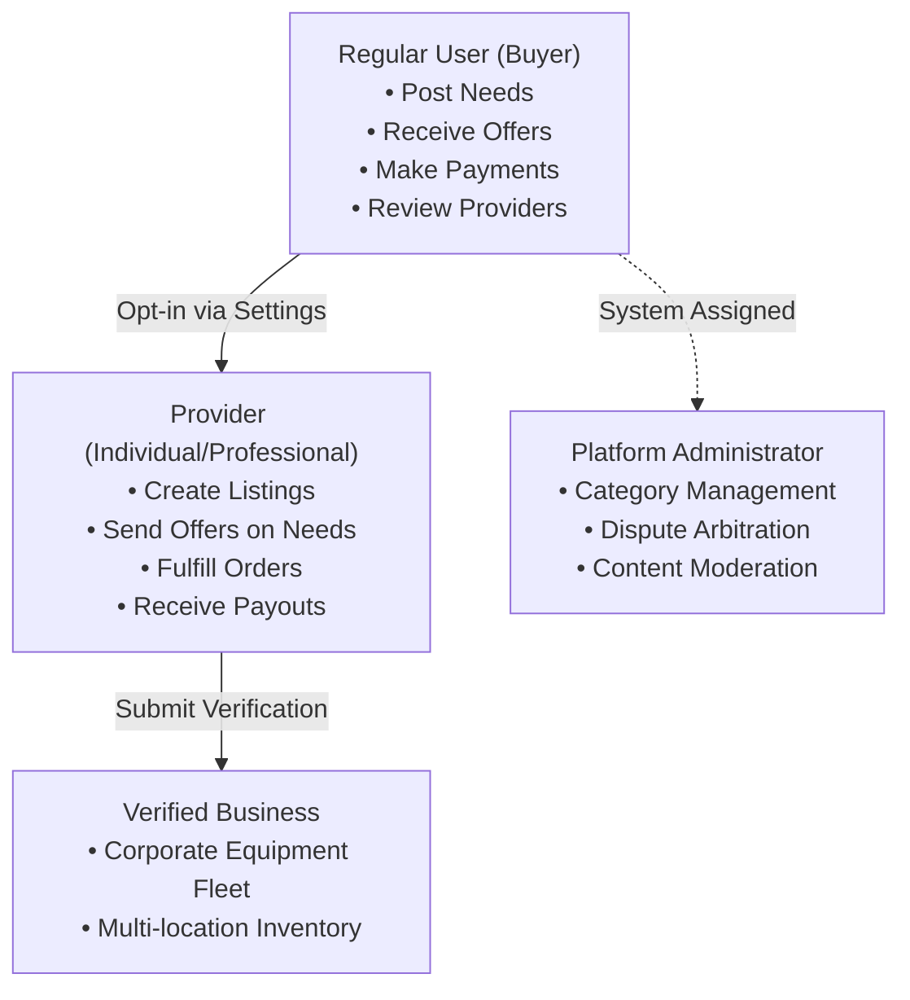

# NEEDX User Manual

> **Version:** 1.0.0 | **Audience:** Buyers, Providers, Business Owners, Platform Administrators

---

## Chapter 1: Introduction & Role Architecture

NEEDX is designed around a simple human truth: **You have a need, and someone nearby can fulfill it.**

Unlike traditional e-commerce platforms that force you into hundreds of confusing menus, NEEDX centers the entire experience around your natural description of what you require.

### User Roles & Permissions
User roles in NEEDX are **additive**, meaning a single account can post needs as a buyer while simultaneously offering equipment or professional services as a provider.

---

## Chapter 2: The Buyer / Need-Poster Journey

### 2.1 Posting Your First Need
1. Navigate to the **NEEDX Homepage** (`/`).
2. Locate the central prompt: **"What do you need?"**
3. Type your requirement naturally. For example:
   > *"I need a cordless drill for 2 days in Gurgaon under ₹500"*
4. The **Semantic Parser** instantly analyzes your sentence and displays a real-time structured preview:
   - **Detected Category:** Tools & Equipment
   - **Transaction Mode:** Rent
   - **Estimated Budget:** ₹500
   - **Duration:** 2 Days
   - **Detected Location:** Gurgaon
5. Click **"Review & Post Need"** to adjust any detected parameters before publishing.

### 2.2 Exploring Matches & Receiving Offers
- Once published, your need enters the **Matching State**.
- The NEEDX matching algorithm automatically scans nearby inventory and ranks listings by relevance, distance, price, and provider trust.
- Nearby verified providers receive a notification and can submit formal **Offers** to your inbox.

### 2.3 Negotiating Offers
1. Open **Dashboard → Offers** (`/dashboard/offers`) or view the need details page.
2. Review the offer details:
   - Proposed Price
   - Security Deposit (if renting)
   - Estimated Delivery / Pickup Method
   - Custom provider terms
3. You have three choices:
   - **Accept Offer:** Locks in the terms and creates an official Order in `PENDING` status.
   - **Counter-Offer:** Propose a different price, revised dates, or special conditions.
   - **Decline:** Politely reject the proposal.

### 2.4 Checkout & Escrow Payment
1. After accepting an offer, navigate to **Orders → Pay Now**.
2. Review the complete financial breakdown:
   - Base Price / Service Fee
   - Security Deposit (fully refundable upon safe return)
   - Platform Service Fee
3. Complete the checkout process. In development mode, you can test this using the simulated checkout screen at `/pay/mock/[ref]`.
4. Once paid, the payment is held in **escrow** by the platform ledger until the transaction is completed.

### 2.5 Inspecting & Returning Rentals
- When renting equipment, verify condition upon handover.
- Upon rental completion, return the item to the provider.
- Once the provider marks the inspection satisfactory, your security deposit is automatically refunded back to your account ledger.

### 2.6 Leaving Reviews & Handling Disputes
- Following completion, rate the provider from 1 to 5 stars and leave written feedback.
- If an item was damaged, misrepresented, or undelivered, click **"Report Issue / Dispute"** on the order page to initiate formal administrative arbitration.

---

## Chapter 3: The Provider / Fulfiller Journey

### 3.1 Activating Provider Mode
1. Sign in to your account.
2. Visit **Settings** and select **"Become a Provider"**.
3. Select your provider type:
   - **Individual:** Freelancer, peer-to-peer lender, or hobbyist.
   - **Professional:** Certified technician, photographer, or contractor.
   - **Business:** Registered equipment rental or commercial firm.

### 3.2 Creating & Managing Listings
1. Navigate to **Provider Portal → Listings → New Listing** (`/provider/listings/new`).
2. Fill in listing details:
   - **Listing Title & Description:** Clear description of item or service.
   - **Listing Type:** Product (Buy/Sell), Service (Hire), or Equipment (Rental).
   - **Pricing & Units:** Fixed price per item, per day, or per hour.
   - **Security Deposit:** Required deposit amount for physical rentals.
   - **Location:** Set your service or pickup address to enable local geospatial radius matching.
   - **Photos:** Upload high-resolution imagery.

### 3.3 Finding Needs & Submitting Offers
1. Go to **Provider Portal → Matching Requests** (`/provider/requests`).
2. Browse active community needs in your city filtered by compatibility with your inventory.
3. Click **"Send Offer"** on any open need:
   - Specify your proposed price.
   - Attach a specific listing from your inventory.
   - Add notes regarding availability, delivery, or warranty.

### 3.4 Order Execution & Rental Inspection
- When a buyer accepts and pays for your offer, the order moves to `PAID`.
- Update the order state to `CONFIRMED` when ready to prepare the item.
- Update to `READY` when available for pickup or dispatched.
- For rentals: When the item is returned, conduct an inspection. If clean and undamaged, click **"Confirm Return & Release Deposit"** to release the renter's funds.

---

## Chapter 4: The Administrator & Moderator Manual

The **Admin Center** (`/admin`) is restricted to accounts possessing the `ADMIN` or `SUPER_ADMIN` role.

### 4.1 Platform Analytics & Monitoring
- **Dashboard Overview:** Displays live gross transaction volume (GMV), active user counts, pending orders, and total escrow held.
- **Audit Logs:** Real-time chronological record of every status transition, dispute opening, and administrative resolution.

### 4.2 Category & Attribute Management
- Access `/admin/categories` to manage the taxonomy tree.
- Define custom attribute schemas for categories (e.g., adding `fuel_type` to Vehicles, or `resolution` to Projectors).

### 4.3 Content Moderation Queue
- Navigate to `/admin/moderation` or `/admin/reports`.
- Review needs, listings, and messages flagged by the automated keyword filter or reported by community members.
- Moderation actions available:
  - **Dismiss Report:** Content confirmed safe.
  - **Warn Author:** Send an automated system warning.
  - **Unpublish / Delete Content:** Remove offensive or prohibited listings immediately.
  - **Suspend User Account:** Prevent further platform interactions.

### 4.4 Dispute Resolution Center
- Navigate to `/admin/disputes`.
- Review disputed orders with comprehensive context: buyer statement, provider response, original agreement terms, and chat history.
- **Arbitration Outcomes:**
  - **Resolve in Favor of Buyer:** Issues full refund to buyer including platform fee.
  - **Resolve in Favor of Provider:** Releases order payout and deposit to provider.
  - **Split Resolution:** Divides funds proportionately according to administrator determination.

---

## Chapter 5: Progressive Web App (PWA) Guide

NEEDX functions as a native-grade mobile application on any compatible smartphone.

### Installing on Android (Google Chrome)
1. Open `https://needx.local` (or your deployment domain) in Chrome.
2. Tap the floating **"Install NEEDX App"** banner at the bottom of the screen (or tap the browser menu `⋮` and select **"Add to Home Screen"**).
3. Confirm installation. The NEEDX icon will appear on your device's home screen and app launcher.

### Installing on iOS (Apple Safari)
1. Open the platform in Safari on iOS.
2. Tap the **Share** button (box with an upward arrow) in the Safari toolbar.
3. Scroll down and select **"Add to Home Screen"**.
4. Tap **"Add"** in the top-right corner.
